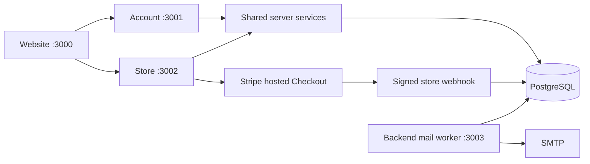

# Architecture

> The default website now includes `/store` and `/account`. See [single-origin routing](single-origin.md) for current URLs, server requirements and migration notes. Standalone app instructions below remain available for separate hosting.

The applications are independent npm workspaces, each with its own Next.js App Router, build output, routes, metadata and runtime port. They share source packages through workspace imports; Next transpiles those packages. No subdomain routing trick or WordPress installation is involved.

## Request boundaries

The main website is prerendered and reads version-controlled editorial content. The account and store render user-specific pages dynamically. Their route handlers import `@void/backend` server modules directly; they do not make an unnecessary HTTP hop through the worker. The backend is an independently runnable Hono process providing health/readiness, public content APIs and persistent email delivery.

## Shared packages

`packages/design-system/tokens.css` owns the requested palette and motion tokens. `styles.css` provides responsive composition, controls, typography and motion fallbacks. `@void/ui` contains the original V mark, voxel illustration, buttons, navigation, footer, dialogs and motion behaviors. `@void/shared` owns public URL configuration, honest content, Zod schemas and integer-money calculations. `@void/config` holds compatible Next, Tailwind and TypeScript settings.

Next.js 16's TypeScript API checker runs in worker threads with two build workers. This avoids OS child-pipe restrictions while retaining full type checking. There is no `ignoreBuildErrors` setting. Unit/integration tests use Node's built-in test runner and an in-process TypeScript loader; the loader transpiles only, so `npm run typecheck` remains a separate required check.

## Authentication

Better Auth owns credential hashing, tokens, session cookies, verification, password reset, OAuth state, CSRF checks and established authentication behavior. The Prisma adapter persists users, provider accounts, sessions and verification records. The application adds bounded inputs, exact-origin checks for custom mutations, account-address rate limits, owned-session revocation, and authorization on every private route.

HTTP-only cookies are shared across localhost ports during development. In production, set `AUTH_COOKIE_DOMAIN=voidclient.org` only if every sibling subdomain is trusted, and provide the same database and auth secret to account and store. Host-only production cookies cannot authenticate the store on another subdomain. Cross-site unrelated domains require a separate SSO design.

## Commerce

The browser submits product IDs, bounded quantities, an idempotency request ID, and consent. Prices and availability come from PostgreSQL and must agree with active one-time Stripe prices. Pending order snapshots are checked again on retries. Carts use a revision counter to reject stale writes, including writes racing with payment completion.

Only a verified Stripe event can mark a payment paid. The event receipt, payment record, order transition and purchased-cart update run in one serializable transaction. Replays are idempotent; late expiration events do not undo payments, and late completion events do not reverse refunds. Transient transaction failures return an error for provider retry.

This implementation supports one currency per cart, integer minor units, one-time per-unit prices, and exclusive tax. Inclusive-tax prices, subscriptions, shipping, discounts, inventory reservations and automatic digital fulfillment are outside the current implemented commerce contract. Do not enable those Stripe product types without adding and testing the corresponding logic.

## Data ownership

Prisma includes all requested user/profile/session/product/category/cart/order/payment/editorial models, plus provider Account, Verification, RateLimit, atomic RateBucket, AuditEvent, encrypted EmailOutbox and PaymentEvent models. Editorial Prisma models are prepared for a future CMS; public website content currently comes from the shared content file. Store products come from PostgreSQL.

The default seed inserts only unpublished FAQ/partner drafts. It never creates users, passwords, products, orders or payments. Tests create labelled synthetic records in a disposable database and clean up their tracked records.
